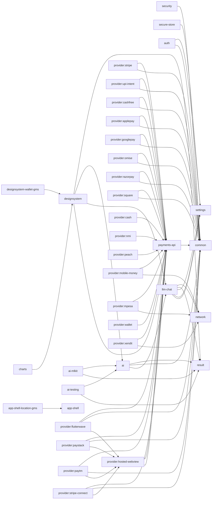

# kmp-toolkit


One repo of small Kotlin Multiplatform libraries, each pulled out of an app of mine once a second app needed the same code. There is no framework here. `result` is a typed `Result<D, E>`, `mvi-core` is a ViewModel base, `payments-api` is a gateway contract with twenty adapters behind it.

<!-- module-counts:begin -->
> **At a glance:** **46 modules**, comprising **26 core/leaf modules**
> and **20 payment-gateway provider modules**. Generated from `settings.gradle.kts`.
<!-- module-counts:end -->

## Why one repo

The libraries began life as separate repos. On 2026-07-14 I merged eight of them into a single Gradle build with one version catalog, so an app collapses several per-library submodules into one (logged in [docs/DECISIONS.md](docs/DECISIONS.md)). Apps still take one module at a time: nothing is pulled in unless a `build.gradle.kts` asks for it. Fourteen of the 46 modules depend on no other module here (the graph below shows the rest).

Maturity is uneven. A few modules are used by several of my apps, and others were extracted and have no second user yet. Read the module's own code and tests before relying on it. If you want the list of who uses what, grep the consumer repos for `com.siddharth.kmp:<module>`.

## Try it

You need [kmp-build-logic](https://github.com/darkpandawarrior/kmp-build-logic) checked out next to this repo, because `settings.gradle.kts` does `includeBuild("../kmp-build-logic")` for the convention plugins.

```bash
git clone https://github.com/darkpandawarrior/kmp-toolkit.git
git clone https://github.com/darkpandawarrior/kmp-build-logic.git
cd kmp-toolkit

./gradlew assemble check --stacktrace   # what CI runs on Linux, minus iOS
./gradlew :network:jvmTest              # one module
node scripts/module-graph.mjs --check   # is the module list below current
```

## Use it from an app

The modules are not on Maven Central or any other registry yet. The repo has a publish workflow for `result`, `common`, `mvi-core` and `network` under `io.github.darkpandawarrior`, but it needs signing secrets that are not set up, and the namespace returns 404 on repo1.maven.org today.

My apps vendor this repo as a git submodule at `external/kmp-toolkit` and substitute coordinates for projects:

```kotlin
// settings.gradle.kts
includeBuild("external/kmp-toolkit") {
    dependencySubstitution {
        substitute(module("com.siddharth.kmp:mvi-core")).using(project(":mvi-core"))
        substitute(module("com.siddharth.kmp:network")).using(project(":network"))
        // one line per module you use
    }
}
```

```kotlin
// build.gradle.kts, no version: the substitution resolves it
dependencies {
    implementation("com.siddharth.kmp:mvi-core")
}
```

`kmp-app-template` is a working example of the wiring: [darkpandawarrior/kmp-app-template](https://github.com/darkpandawarrior/kmp-app-template).

## Modules

Every module builds as a Kotlin Multiplatform library unless noted. Open the module's `build.gradle.kts` for its exact targets, since a module only declares what its own consumers needed.

**Foundations**

| Module | What it is |
|---|---|
| `result` | `Result<D, E>` and `DataError`, typed error handling |
| `common` | `AppLog` (a Napier facade), `DispatcherProvider`, `UiText`, formatters |
| `mvi-core` | `BaseViewModel`, `StateViewModel`, `EffectEmitter` |
| `network` | Ktor client factory, retry, 401 handling, connectivity |
| `store` | `ScreenState`, `DecisionEngine` and `FetchPolicy` for offline-first screens, no HTTP dependency |
| `netlog` | In-memory Ktor request logger with credential redaction and `toCurl()` |
| `auth` | `TokenStore`: an in-memory token and a persisted one over any `Settings` |
| `settings` | Encrypted key/value settings behind multiplatform-settings' `Settings` |
| `offline-outbox` | Room-backed submit outbox with retry on reconnect. Targets watchOS as well |

**Security and device**

| Module | What it is |
|---|---|
| `security` | Android only on purpose: root and hook detection, `FLAG_SECURE`, certificate pinning, Keystore |
| `device-integrity` | the cross-platform root/jailbreak check, `DeviceIntegrity.inspect()` |
| `biometric` | one suspending `authenticate()` over `BiometricPrompt` and `LAContext` |
| `secure-store` | encrypted key/value over Keystore and Keychain |
| `location` | GPS track math: Kalman smoothing, path simplification, fix-quality scoring |
| `app-shell` | seams for platform services with no single KMP library: geocoding, scanner, notifications, permissions, in-app update and review, push, analytics |
| `app-shell-location-gms` | opt-in fused location via Play Services, split out so other builds carry no play-services-location |

**UI and AI**

| Module | What it is |
|---|---|
| `designsystem` | brand-agnostic Compose primitives, spacing and motion tokens, theme controller, `MarkdownText`. No palette, see [DESIGN.md](DESIGN.md) |
| `designsystem-wallet-gms` | opt-in Google Pay button, kept out of `designsystem` |
| `charts` | `TimeSeriesChart`, a Vico wrapper over the design tokens |
| `feedback` | synthesised sound and haptics |
| `ai` | one on-device LLM seam over MediaPipe, Foundation Models and a cloud fallback |
| `ai-mlkit` | opt-in Gemini Nano implementation for `ai` |
| `ai-testing` | `FakeOnDeviceLlm` and `RecordingLlm`, so tests need no model or device |
| `llm-chat` | cloud chat behind one `AiProvider` seam: Gemini, OpenAI, Anthropic |
| `bots-policy` | a generic ISMCTS search shell with no dependencies |

**Payments**

`payments-api` holds the `PaymentGateway` and `PaymentBackend` contract, `Money`, `PaymentResult`, redaction and a `StubGateway`, so the contract runs with no live credentials. Each `provider:*` module is one adapter. Eleven are Android only (`cashfree`, `flutterwave`, `googlepay`, `omise`, `paystack`, `paytm`, `razorpay`, `square`, `stripe`, `stripe-connect`, `upi-intent`), `applepay` is iOS only, and the other eight target Android and iOS (`hosted-webview` also builds for wasmJs). All twenty are `applepay`, `cash`, `cashfree`, `flutterwave`, `googlepay`, `hosted-webview`, `mobile-money`, `mpesa`, `nmi`, `omise`, `paystack`, `paytm`, `peach`, `razorpay`, `square`, `stripe`, `stripe-connect`, `upi-intent`, `wallet` and `xendit`.

`secrets/` is not a Gradle module. It is a small SOPS and age vault with an alias manifest, a worked example of resolving secrets without keeping any in git (`secrets/test.sh` exercises it).

### Optional Google services

ML Kit and Google Pay moved out of `ai` and `designsystem` on 2026-10-04, so a build without Play services carries neither. Apps that want them add `ai-mlkit` and `designsystem-wallet-gms` and register their Koin modules. This broke Play-enabled consumers on the next bump, and [docs/gms-opt-in.md](docs/gms-opt-in.md) has the steps.

## How the modules depend on each other

The edges below are generated from the build files, so do not edit between the markers. Every provider depends on `payments-api`; the 12 other modules with dependencies take between one and four.

<!-- module-graph:begin -->
<!-- generated by scripts/module-graph.mjs - do not hand-edit inside these markers -->



_46 modules, 64 internal dependencies._
<!-- module-graph:end -->

## CI and quality

`.github/workflows/ci.yml` runs two jobs. On Linux it runs `./gradlew assemble check -Pkotlin.native.ignoreDisabledTargets=true`, which covers the Android, JVM and wasm tests and lint. A separate macOS job compiles the iOS source sets, because Kotlin/Native cannot build on Linux and a green Linux run used to hide iOS breakage. Other workflows build the Dokka site, notify the consuming apps when `main` moves, and reject commits carrying AI attribution lines.

There are 105 `*Test.kt` files across the modules. detekt runs with no baseline files: on 2026-09-22 all 116 baselined findings were fixed in code instead (see the decisions log).

API docs: [darkpandawarrior.github.io/kmp-toolkit](https://darkpandawarrior.github.io/kmp-toolkit/). Background on the wider family of repos: [cv-siddharth.vercel.app/project/kmp-family](https://cv-siddharth.vercel.app/project/kmp-family).

## Versions

Pinned in `gradle/libs.versions.toml` at the time of writing: Kotlin 2.5.0-Beta2, AGP 9.6.0-alpha03, Compose Multiplatform 1.13.0-beta02, Ktor 3.6.1, Koin 4.2.2, kotlinx-coroutines 1.11.0, Room 2.8.5. The toolkit itself is version 2.0.0 (`VERSION`).

MIT licence.
